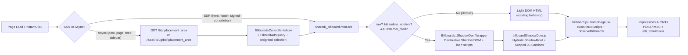

# Forem Billboards: Architecture, Authoring & Programmatic API Guide

This document is the source of truth for how Forem's Billboard system (`Billboard`, table `display_ads`) works end-to-end: placement areas, targeting, caching, campaign pacing, HTML-first (`raw`) authoring with opt-in Shadow DOM & JS sandbox isolation (`isolate_content`), dark-mode styling conventions, site-wide interactivity contracts, and programmatic REST API access.

---

## Table of Contents

1. [Core Concepts & Data Model](#1-core-concepts--data-model)
2. [Delivery & Rendering Pipeline](#2-delivery--rendering-pipeline)
3. [Placement Areas & Placement Config](#3-placement-areas--placement-config)
4. [Targeting, Filtering & Suppression](#4-targeting-filtering--suppression)
5. [Campaigns, Delivery Caps & Ideal Daily Impressions Pacing](#5-campaigns-delivery-caps--ideal-daily-impressions-pacing)
6. [HTML-First (`raw`) Billboards & Shadow DOM Isolation (`isolate_content`)](#6-html-first-raw-billboards--shadow-dom-isolation-isolate_content)
   - [CSS & DOM Isolation Contract](#css--dom-isolation-contract)
   - [How Author CSS Interacts with Forem's Base Styles](#how-author-css-interacts-with-forems-base-styles)
   - [Light Mode / Dark Mode Authoring DSL](#light-mode--dark-mode-authoring-dsl)
   - [Scoped JavaScript Sandbox & `billboard` Runtime API](#scoped-javascript-sandbox--billboard-runtime-api)
   - [Site-Wide Interactivity Preservation](#site-wide-interactivity-preservation)
   - [Complete Copy-Paste Example](#complete-copy-paste-example)
7. [Programmatic Access (REST API)](#7-programmatic-access-rest-api)
   - [Authentication & Sub-Permissions](#authentication--sub-permissions)
   - [Billboards API (`/api/billboards`)](#billboards-api-apibillboards)
   - [Billboard Campaigns API (`/api/billboard_campaigns`)](#billboard-campaigns-api-apibillboard_campaigns)
   - [Audience Segments API (`/api/segments`)](#audience-segments-api-apisegments)
   - [End-to-End Programmatic Workflow (`curl`)](#end-to-end-programmatic-workflow-curl)
8. [Public Delivery, Tracking & Cross-Origin Embeds](#8-public-delivery-tracking--cross-origin-embeds)
9. [Key Source Files](#9-key-source-files)

---

## 1. Core Concepts & Data Model

Billboards are Forem's native promotional, community, announcement, and sponsorship display units (`app/models/billboard.rb`, backed by the `display_ads` table).

### Core Enums & Attributes

| Attribute | Values | Default | Notes |
| --- | --- | --- | --- |
| `type_of` | `in_house`, `community`, `external` | `in_house` | `community` requires `organization_id`. `external` renders as `"partner"` in `data-type-of`, respects user `display_sponsors` and author `permit_adjacent_sponsors` opt-outs. `home_hero` must be `in_house`. |
| `render_mode` | `forem_markdown`, `raw` | `forem_markdown` | `forem_markdown` runs through `ContentRenderer` (Markdown + Liquid tags). `raw` preserves arbitrary HTML/CSS/JS while still prefixing images and appending `?bb=<id>` to links. |
| `isolate_content` | `false`, `true` | `false` | Opt-in Shadow DOM + scoped JS sandbox for on-site `render_mode: "raw"` billboards. **Off by default** so existing billboards are unaffected and special-purpose billboards can opt out. |
| `template` | `authorship_box`, `plain` | `authorship_box` | `authorship_box` renders Forem's card chrome and header (`_billboard_header.html.erb`, org avatar/label, `...` dropdown, close button where applicable). `plain` renders bare content inside `.crayons-bb--plain`. |
| `special_behavior` | `nothing`, `delayed`, `persistent` | `nothing` | `delayed` reveals after 10 seconds. `persistent` (for fixed-bottom popovers) requires `minimized_body_markdown` and minimizes into the right sidebar (`#persistent-minimized-billboard-container`) on dismiss or internal navigation. |
| `display_to` | `all`, `logged_in`, `logged_out` | `all` | Controls auth-state eligibility. |
| `browser_context` | `all_browsers`, `desktop`, `mobile_web`, `mobile_in_app` | `all_browsers` | Filters by client user-agent / viewport context. |
| `approved` & `published` | `boolean` | `false` | Both must be `true` (and neither the billboard's `expires_at` nor its campaign's `expires_at` may be in the past) for a billboard to enter rotation. |
| `weight` & `priority` | `0.0..10_000.0`, `boolean` | `1.0`, `false` | Controls weighted share inside the `new_and_priority` selection strategy (also steered automatically by campaign pacing). |

### Automatic Processing on Save

1. **Markdown / HTML Processing (`before_validation :process_markdown`)**:
   - `forem_markdown`: processed via `ContentRenderer` (supports Liquid tags such as ``, ``, ``, ``, etc.) and images are prefixed/optimized (`width: 775` for post placements, `350` for sidebars).
   - `raw`: passed through `Html::Parser#prefix_all_images(width: 880, quality: 100)`. Add `data-ignore-prefix="true"` to an `` tag to skip image proxying/prefixing.
   - `minimized_body_markdown` is processed using the same `render_mode` into `minimized_processed_html`.
2. **Automatic Attribution (`after_save :update_links_with_bb_param`)**:
   - Every `<a href="...">` starting with `http` or `/` in `processed_html` automatically gets `?bb=<billboard_id>` appended (or updated).
   - Also balances unclosed HTML tags via Nokogiri.
3. **Automatic Self-Exclusion (`before_save :update_exclude_article_ids`)**:
   - Internal article links inside `processed_html` are extracted and added to `exclude_article_ids` so a billboard promoting an article does not show on that same article.
4. **Cache Invalidation**:
   - Changes to content fields (`body_markdown`, `minimized_body_markdown`, `name`, `placement_area`, `color`, `template`, `render_mode`, `isolate_content`) update `content_updated_at`, automatically invalidating the 12-hour fragment cache in `app/views/billboards/show.html.erb` and purging the homepage edge cache for `HOME_PAGE_PLACEMENTS`.

---

## 2. Delivery & Rendering Pipeline



### Render Entry Points

- **Async containers** (`app/javascript/packs/billboard.js`): Finds `.js-bb-c`, `.js-billboard-container`, `.new-bb-container`, `.sidebar-bb`, `.below-post-bb`, `.feed-bb-c` elements with `data-async-url`, fetches HTML from `BillboardsController#show`, inserts it, runs `executeBBScripts`, `implementSpecialBehavior`, `setupBillboardInteractivity`, and `observeBillboards`.
- **Signed-in Home Feed** (`app/javascript/articles/Feed.jsx` + `homePageFeed.jsx` + `homePage.jsx`): Fetches `/bb/feed_first`, `/bb/feed_second`, `/bb/feed_third` in parallel with `/stories/feed`, injects them into the Preact feed via `dangerouslySetInnerHTML`, and calls `afterHomeFeedRender()`.
- **Signed-in Home Sidebar** (`homePage.jsx`): Fetches `/sidebars/home` (which renders `shared/billboard` for `sidebar_right`, `sidebar_right_second`, `sidebar_right_third`).
- **SSR Placements**: Home hero (`articles/index.html.erb`), signed-out feed sidebars (`stories/_main_stories_feed.html.erb`), and footer (`layouts/_footer.html.erb`).
- **Admin Previews**: `admin/billboards/_form.html.erb`, `admin/billboards/show.html.erb`, and `admin/events/show.html.erb` (when `raw? && isolate_content?`, previews are always isolated even for `external_feed`).

---

## 3. Placement Areas & Placement Config

### All 22 Allowed Placement Areas

| Group | Placement Areas (`placement_area`) | Notes |
| --- | --- | --- |
| **Left Sidebar** | `sidebar_left`, `sidebar_left_2` | Global/nav left sidebar slots. |
| **Right Sidebar (Home)** | `sidebar_right`, `sidebar_right_second`, `sidebar_right_third` | Rendered via `/sidebars/home` (signed-in) or SSR (signed-out). |
| **Home Feed** | `feed_first`, `feed_second`, `feed_third` | Inserted at feed positions 0, 2, 7. Support `dismissal_sku` close button and user followed-tag targeting. |
| **Home Hero & Footer** | `home_hero`, `footer` | `home_hero` requires `type_of: "in_house"` and `:hero_billboard` feature flag. |
| **Fixed-Bottom Popovers** | `post_fixed_bottom`, `page_fixed_bottom` | Slide-up bottom drawer; supports `special_behavior: "persistent"` with `minimized_body_markdown`. `post_fixed_bottom` is automatically suppressed in embedded IDE/mobile webviews and `?context=digest`. |
| **Post Body Bottom** | `post_body_bottom`, `post_body_bottom_secondary` | Below article body; automatically shows a **Read More** fold if `processed_html_final.size > 750` (excluding surveys). |
| **Post Sidebar** | `post_sidebar`, `post_sidebar_secondary` | Primary & secondary slots are randomized per page load via `.js-bb-shuffle-group`. |
| **Post Comments** | `post_comments`, `post_comments_secondary`, `post_comments_mid` | Below or midway through comments. |
| **Digest Emails** | `digest_first`, `digest_second` | Rendered inside `digest_mailer/digest_email.html.erb` (plain email HTML; no Shadow DOM). |
| **External Embed** | `external_feed` | Bare HTML for third-party sites in `BILLBOARD_EMBED_ORIGINS` (`Access-Control-Allow-Origin: *`, `data-context-type="embed"`, never wrapped in Shadow DOM). |

### Placement Area Configuration (`BillboardPlacementAreaConfig`)

Configured at `/admin/customization/billboard_placement_area_configs`:

- **`signed_in_rate` / `signed_out_rate`** (`0..100`): Probability percentage that a request fetches a billboard for that area (default `100`). Overridden to `100` for `feed_first` and `post_fixed_bottom` during active broadcast events.
- **`cache_expiry_seconds`** (`0..86400`, default `180`): Edge cache TTL (`Surrogate-Control` / `X-Accel-Expires`).
- **`fully_cached`** (`boolean`): When `true`, contextual placements serve a single shared edge-cached URL (`/bb/:placement_area`) per geo & `X-Loggedin` state (skipping per-article/per-user targeting). Only request-independent billboards are eligible.
- **`hidden_by_default`** (`boolean`): Renders with `data-placement-hidden="true"` (`display: none !important`) and **records zero impressions** until frontend code calls:
  ```js
  window.Forem.revealBillboardPlacement('post_sidebar');
  ```
  Calls made before the deferred `application` pack boots are automatically queued in `window.Forem.queuedBillboardPlacementReveals` and replayed on load. Revealed placements reset automatically on InstantClick navigation.
- **`selection_weights`**: Relative weights across selection strategies:
  - `weighted_performance` (default `60`): Samples from top `1..15` candidates ordered by `success_rate DESC`.
  - `new_and_priority` (default `30`): Weighted random selection among low-impression or `priority: true` billboards.
  - `new_only` (default `5`): Random among low-impression billboards (with fallback to top 15).
  - `random_selection` (default `5`) / `evenly_distributed` (default `0`): Uniform random sample.

---

## 4. Targeting, Filtering & Suppression

Candidate selection runs through `Billboards::FilteredAdsQuery` (accelerated by `ForemNative.build_filtered_ads_where_sql` in Rust when applicable):

- **Auth & Roles**: `display_to` (`all`, `logged_in`, `logged_out`), `target_role_names`, `exclude_role_names`.
- **Audience Segments**: `audience_segment_id` / `audience_segment_type` (automatic or manual segments managed via `/api/segments`).
- **Tags**: `tag_list` (max 25 tags) matches article tags on post placements and top followed tags on home feed placements. Untagged billboards match everywhere.
- **Articles & Pages**: `exclude_article_ids`, `preferred_article_ids` (10x weight multiplier when `:article_id_adjusted_weight` flag is enabled), `page_id`, `include_subforem_ids`.
- **Geolocation**: `target_geolocations` (ISO 3166-2 codes like `US-NY`, `CA-ON`, `GB`; requires `:billboard_location_targeting` flag). Signed-in uncached requests read `X-Client-Geo`; edge-cached responses read and `Vary` on `X-Cacheable-Client-Geo`.
- **Cookies & Surveys**: `requires_cookies` (only served when `localStorage.cookie_status === 'allowed'`), `exclude_survey_completions` + `exclude_survey_ids`.
- **Client-Side Dismissal**: Setting `dismissal_sku` enables a close button and stores dismissed SKUs in `localStorage.dismissal_skus_triggered`.
- **Testing / Previewing a Specific Billboard Live**:
  Append query parameters to any page containing that placement area:
  ```
  ?bb_test_placement_area=post_sidebar&bb_test_id=123
  ```
  Admins can preview unapproved/draft billboards this way; non-admins can only force already-approved & published billboards.

---

## 5. Campaigns, Delivery Caps & Ideal Daily Impressions Pacing

`BillboardCampaign` (`app/models/billboard_campaign.rb`) groups multiple billboards under shared constraints:

- **Shared Expiration (`expires_at`)**: Enforced immediately at query time (`Billboard.approved_and_published` and `Billboards::FilteredAdsQuery` exclude billboards whose campaign has expired) and takes down all member billboards when the campaign expires.
- **Delivery Caps (`max_impressions_count`, `max_clicks_count`)**: Set on either a `BillboardCampaign` (summed across all member billboards, including unapproved/paused ones) or an individual `Billboard`. `0` means unlimited. Once reached, affected billboards — or all approved billboards in the campaign when a campaign limit trips — are automatically unapproved (`approved: false`).
- **How Expiration & Cap Enforcement Runs (`Billboards::EnforceDeliveryLimits`)**:
  - **Immediate on save (API & Admin UI)**: Updating a `BillboardCampaign` to an already-expired `expires_at` or a reached impression/click cap immediately unapproves all approved member billboards, unpublishes any `LiquidEmbedReference` rows, purges affected billboard and homepage edge caches, and refreshes the campaign throttle cache. Tightening a `Billboard`'s own cap below its current counts — or moving a billboard with existing counts into a campaign so the campaign reaches its cap — likewise enforces takedown immediately on commit.
  - **Event-driven campaign-wide takedown (`Billboards::DataUpdateWorker`)**: When newly tabulated counts push a billboard or its campaign over a cap, `Billboard#check_and_handle_delivery_limits` unapproves the billboard — or the entire campaign if a campaign limit was reached — in the same run. Billboards with an active individual or campaign cap never skip tabulation via the high-impression random backoff.
  - **Scheduled 5-minute sweep (`Billboards::EnforceDeliveryLimitsWorker`)**: Runs every 5 minutes (`*/5 * * * *`) to take down any approved billboards or campaigns whose `expires_at` passed or whose tabulated counts reached a cap without waiting for incoming traffic events, purging edge caches, homepage caches, and Liquid embed references cleanly.
- **Ideal Daily Impressions Titration (`ideal_daily_impressions`)**:
  - Set `ideal_daily_impressions > 0` on a `BillboardCampaign` to pace campaign delivery smoothly over each 24-hour day.
  - Every 10 minutes (`144` windows/day), `Billboards::TitrateCampaignImpressionsWorker` evaluates actual vs. traffic-adjusted expected impressions via `Billboards::CampaignPacing` (`deadband: 0.90..1.10`, smoothing prior `3.0`, control gain `0.6`) and steers three monotonic levers in order:
    1. **`Billboard#weight`** (`0.01..10_000.0`) — scales relative share inside `new_and_priority`. Explicitly muted creatives (`weight == 0.0`) stay muted if other creatives in the campaign have positive weight.
    2. **`Billboard#priority`** (`true`/`false`) — toggled off once weight drops to `<= 1.0`.
    3. **`BillboardCampaign#delivery_throttle_rate`** (`0.0..1.0`) — probabilistic admission gate evaluated in `FilteredAdsQuery` (served from an L1 in-process cache `billboards:throttled_campaign_rates:v1` so there is zero per-request Redis overhead). Engaged only if a campaign still over-delivers after priority is off and weight is at the floor (e.g., high-CTR creatives favored by `weighted_performance`).
  - Setting `ideal_daily_impressions` back to `0` immediately resets `delivery_throttle_rate` to `1.0` and refreshes the throttle cache.

---

## 6. HTML-First (`raw`) Billboards & Shadow DOM Isolation (`isolate_content`)

HTML-first billboards use `render_mode: "raw"` to embed custom HTML, `<style>`, and `<script>` directly.

To prevent CSS leaks, DOM ID collisions, malformed HTML tags, JS global pollution, unhandled exceptions, or leaked timers from breaking the rest of the Forem page (or sibling billboards), set **`isolate_content: true`** alongside **`render_mode: "raw"`**.

> **Rollout Safety**: `isolate_content` defaults to `false`. Existing raw billboards render in the light DOM exactly as before until explicitly opted in, and special-purpose raw billboards that intentionally need host-page DOM access can leave `isolate_content: false`. Isolation is also automatically skipped for `forem_markdown` billboards, `external_feed` embeds, and digest emails.

### CSS & DOM Isolation Contract

When `render_mode == "raw"` and `isolate_content == true`, `Billboards::ShadowDomWrapper` wraps the billboard body in an **open Declarative Shadow DOM**:

```html
<div class="billboard-shadow-host"
     data-billboard-shadow-host="true"
     data-billboard-id="123"
     data-billboard-template="authorship_box">
  <template shadowrootmode="open">
    <style data-billboard-base-styles="true">/* @layer { enforced :host rules } @layer forem-billboard-base { defaults } */</style>
    <div class="billboard-shadow-body">
      <!-- Balanced HTML + <style> + inert <script data-billboard-script="true"> -->
    </div>
  </template>
</div>
<script data-billboard-shadow-bootstrap="true">/* tiny rolling-deploy/legacy fallback */</script>
```

**What this guarantees:**
- **No CSS leakage out**: Rules like `h1 { color: red; }`, `* { margin: 0; }`, `.btn { ... }`, or `@keyframes pulse` stay strictly inside the billboard's ShadowRoot and cannot affect the host page or other billboards.
- **No layout / stacking escape**: `:host` enforces `display: block; min-width: 0; max-width: 100%; contain: layout style; isolation: isolate;` with `!important` in the first cascade layer of the ShadowRoot, so neither billboard CSS nor host-page CSS can turn them off (see [below](#how-author-css-interacts-with-forems-base-styles)). Even an accidental `position: fixed; inset: 0; z-index: 99999` stays trapped inside the billboard's own box and stacking context (it cannot cover the navbar, modals, or the billboard's own `...` header dropdown).
- **Malformed HTML protection**: `Nokogiri::HTML5.fragment` auto-closes missing tags, discards stray closing tags (`</div>`, `</aside>`, `</main>`, `</template>`), closes unclosed comments/styles/scripts at fragment EOF, and strips `<base>` and `<meta http-equiv="refresh">`.
- **Overridable Forem base styles**: Inside the ShadowRoot, the `forem-billboard-base` cascade layer provides `box-sizing: border-box`, responsive media sizing (preserving height-only badges like `height="20"`), `authorship_box` typography and link defaults, and built-in styling for `.ltag_cta`, `.ltag_cta--branded`, `.c-cta`, `.c-cta--branded`, `.crayons-btn`, `.crayons-btn--secondary`, and `.crayons-btn--ghost`. Because unlayered author styles always beat layered styles, **any author CSS rule wins regardless of specificity, without `!important`**.
- **Rolling-deploy & async safety**: SSR pages parse `<template shadowrootmode="open">` natively with zero FOUC. Async-fetched billboards (`innerHTML` / Preact `dangerouslySetInnerHTML`) keep `<style>` inert inside `<template>` until `mountBillboardShadowHosts` upgrades them — and the tiny bootstrap script ensures even stale pre-deploy cached clients never render a blank box.

### How Author CSS Interacts with Forem's Base Styles

Forem injects one `<style data-billboard-base-styles="true">` as the **first** stylesheet in every billboard ShadowRoot. It has two parts, and they behave differently on purpose:

| Part | How it is declared | What it contains | Can billboard CSS override it? |
| --- | --- | --- | --- |
| Isolation guarantees | An anonymous `@layer { ... }`, declared first, every declaration `!important` | `:host { display: block; min-width: 0; max-width: 100%; contain: layout style; isolation: isolate; }` | **No** |
| Defaults | `@layer forem-billboard-base { ... }` | `overflow-wrap` and `box-sizing` on `:host`, `.billboard-shadow-body` flow root, `box-sizing: border-box` on all elements, media sizing, `authorship_box` typography and link styles, `.ltag_cta` / `.c-cta` / `.crayons-btn` styling | **Yes**, by any rule you write |

#### The rule: your CSS beats Forem's defaults

Any normal (non-`!important`) rule you write outside `@layer` beats every Forem default, **whatever its specificity**. Cascade layers are compared before specificity, and unlayered styles rank above all layers. So `p { margin: 0; }` removes the `authorship_box` paragraph margin, and `.cta { color: red; text-decoration: none; }` replaces the branded link color and underline. You don't need `!important`, `:host(...)` prefixes, or extra-specific selectors to override a default.

Two keywords are handy when you only want part of a default:
- `revert-layer` (in an unlayered rule) rolls a property back to the value from the layers below it, which is Forem's default when you haven't declared layers of your own.
- `revert` rolls a property back to the browser default, skipping Forem's defaults entirely.

#### What stays enforced, and why

The five `:host` properties above are what keep a billboard inside its slot. `display: block` keeps the host a real box, because layout containment does nothing on `display: contents` or inline boxes. `min-width: 0` and `max-width: 100%` stop wide content from blowing out the page's grid columns. `contain: layout style` makes the host the containing block for `position: fixed` descendants and scopes CSS counters. `isolation: isolate` gives the billboard its own stacking context, so `z-index: 99999` can't climb above the navbar or the billboard's own `...` menu.

They are enforced with `!important` inside the first, anonymous layer because, for `!important` declarations, the cascade reverses layer order: the earliest layer wins, and layered beats unlayered. That means:
- No author CSS can override them: not an unlayered `:host { display: inline !important; }`, not `!important` inside your own `@layer`, and not rules appended to `@layer forem-billboard-base`. An anonymous layer can't be reopened, so nobody can add rules to it.
- Host-page CSS and inline styles can't override them on the shadow host either. For `!important` declarations, styles inside a shadow tree beat the outer page's styles for that host. To hide or resize a billboard from the page, target an ancestor instead (for example, the `[data-display-unit]` wrapper, which is what `data-placement-hidden` already does).

To size or lay out your billboard, style your own wrapper element or `.billboard-shadow-body` instead of `:host` (for example `.card { display: grid; max-width: 480px; margin-inline: auto; }`). Every other `:host` property, such as `background`, `padding`, `border`, `border-radius`, `font`, or `color`, stays yours to style.

#### Using your own `@layer`s

- **Your layers also beat Forem's defaults.** Layer order follows first declaration. The base stylesheet comes first in the ShadowRoot, so `forem-billboard-base` is always declared before any layer you declare, and a rule like `@layer promo { p { margin: 0; } }` wins. Among your own styles, the usual rules apply: later layers beat earlier ones, and your unlayered rules beat all of your layers.
- **Keep your stylesheets after the base stylesheet.** Inline `<style>` tags in the billboard body, `document.head.appendChild(style)` (which appends into the ShadowRoot), and `billboard.root.adoptedStyleSheets` are all ordered after it. Don't `document.head.prepend(style)` or insert a `<style>` before the first child of `billboard.root`: a layer first declared there would rank *below* `forem-billboard-base`, and Forem's defaults would beat it.
- **Don't write into `@layer forem-billboard-base`.** It works, but your rules would then compete with Forem's defaults on specificity and source order, and the layer's contents can change without notice. Write unlayered rules or use your own layer names.

#### Behavior changes from the original release

The first release of `isolate_content` (forem/forem#24901) described its base styles as zero-specificity `:where(...)` rules that any author rule would beat. That wasn't true for every rule, so this changed:

1. **Defaults are now always overridable.** The `authorship_box` rules were written as `:host([data-billboard-template='authorship_box']) :where(...)`. The `:host(...)` part sits outside `:where`, so those rules scored `(0, 2, 0)` and beat ordinary author selectors such as `p` or `.cta`: links kept the branded color and underline, and paragraphs kept a 16px bottom margin. All defaults now live in `forem-billboard-base` and lose to any author rule. Billboards that worked around the old behavior with `!important` or extra specificity keep rendering the same.
2. **The isolation properties are now actually enforced.** They used to be plain unlayered `:host` rules, so a later author rule like `:host { display: inline; contain: none; max-width: none; }` won on source order, and host-page CSS on `.billboard-shadow-host` won as well. Neither can override them now. A billboard that set `display`, `min-width`, `max-width`, `contain`, or `isolation` on `:host` should move that styling onto its own wrapper element.
3. **`overflow-wrap` and `box-sizing` on `:host` became defaults.** They moved into `forem-billboard-base` and can be overridden like any other default.

**Browser support:** cascade layers ship in Chrome and Edge 99+, Firefox 97+, and Safari 15.4+, which covers every browser that parses Declarative Shadow DOM (`shadowrootmode`). A browser that can attach a ShadowRoot but doesn't support `@layer` ignores the whole base stylesheet. Its billboards lose the CTA and button defaults, but the host still gets `display`, `min-width`, `max-width`, `contain`, and `isolation` from Forem's light-DOM `:where(.billboard-shadow-host)` rule.

### Light Mode / Dark Mode Authoring DSL

Isolated billboards support light and dark mode automatically through **three authoring mechanisms**:

#### 1. Forem CSS Custom Properties (Recommended — Automatic)
CSS custom properties inherit natively across the Shadow DOM boundary, and Forem's dark theme (`themes/dark.css`) updates them on `:root`. Use these tokens so your billboard automatically matches every Forem theme and custom brand color:

| Token | Purpose |
| --- | --- |
| `--card-bg`, `--card-secondary-bg`, `--card-tertiary-bg` | Card & nested surface backgrounds |
| `--body-bg`, `--body-color` | Page background & primary text color |
| `--card-color`, `--card-color-secondary`, `--card-color-tertiary` | Primary, secondary, and muted text on cards |
| `--card-border`, `--card-secondary-border`, `--divider` | Subtle borders & dividers |
| `--accent-brand`, `--accent-brand-lighter`, `--accent-brand-darker` | Community primary brand color |
| `--link-branded-color`, `--link-branded-color-hover` | Branded link colors |
| `--cta-branded-bg`, `--cta-branded-bg-hover`, `--cta-branded-color`, `--cta-branded-border` | Branded CTA button tokens |
| `--button-primary-bg`, `--button-primary-color`, `--button-secondary-bg`, `--button-secondary-color` | Primary & secondary button tokens |
| `--su-1` .. `--su-10` | Spacing scale (`0.25rem` .. `4rem`) |
| `--fs-xs`, `--fs-s`, `--fs-base`, `--fs-l`, `--fs-xl`, `--fs-2xl` | Typography scale |
| `--ff-sans-serif`, `--ff-serif`, `--ff-monospace` | Font stacks (`@font-face` rules also pierce Shadow DOM) |
| `--radius`, `--radius-auto`, `--radius-xl` | Border radii |

#### 2. Mirrored `.dark-theme` Class & `data-theme` Attribute (For Custom Overrides)
`billboardShadowDom.js` observes `document.body`'s `class` attribute and keeps both the shadow host and `.billboard-shadow-body` synced live with:
- Class: `.dark-theme` (toggled on/off with `document.body.classList.contains('dark-theme')`)
- Attribute: `data-theme="dark"` or `data-theme="light"`

All of these selector forms work in Chrome, Firefox, and Safari:

```css
/* Default (light mode) */
.promo-card {
  background: #f8fafc;
  color: #0f172a;
  border: 1px solid #e2e8f0;
}

/* Dark mode override — any of these work identically: */
.dark-theme .promo-card {
  background: #141820;
  color: #f1f5f9;
  border-color: rgba(255, 255, 255, 0.14);
}

/* Or using data-theme / :host: */
[data-theme="dark"] .promo-card { ... }
:host(.dark-theme) .promo-card { ... }
:host([data-theme="dark"]) .promo-card { ... }
```

> **Important Gotcha**: Do **not** write `body.dark-theme .promo-card` inside an isolated billboard. Because `<body>` lives outside the ShadowRoot, `body.dark-theme ...` will not match — use `.dark-theme .promo-card` or `:host([data-theme="dark"]) .promo-card` instead.

#### 3. Native CSS `light-dark()` (Modern Browsers)
Because Forem sets `color-scheme: dark` in dark mode, `color: light-dark(#111, #f5f5f5)` also works inside Shadow DOM in modern browsers.

### Scoped JavaScript Sandbox & `billboard` Runtime API

Executable `<script>` tags inside an isolated raw billboard are neutralized on the server (`type="application/x-forem-billboard-script"`) and executed by `app/javascript/utilities/billboardShadowDom.js` inside a per-billboard sandbox (`"use strict"` + `try/catch` error boundary).

#### How Standard Globals Behave Inside the Sandbox

| API | Isolated Behavior |
| --- | --- |
| `document.getElementById(id)`, `querySelector`, `querySelectorAll`, `getElementsByClassName`, `getElementsByTagName`, `getElementsByName` | **Scoped to this billboard's `ShadowRoot`**. Duplicate IDs across two billboards (or the host page) never collide. |
| `document.querySelector('meta[...]')`, `document.head.querySelector('meta[...]')` | Checks `ShadowRoot` first, then falls back **read-only** to the host document's `<meta>` tags (so `meta[name="csrf-token"]` and `meta[name="user-signed-in"]` remain readable). |
| `document.body`, `document.documentElement` | Points to `.billboard-shadow-body` inside the `ShadowRoot` (so `document.body.classList.contains('dark-theme')` works and mutations stay inside the billboard). |
| `document.head.appendChild(styleEl)` | Appends into the billboard's `ShadowRoot` — dynamically created `<style>` elements stay isolated. |
| `document.write`, `writeln`, `open`, `close`, `document.title = ...` | **Safely blocked** (logs a console warning) so a billboard can never wipe the page or hijack `<title>`. |
| `window.foo = ...` / `self.foo = ...` / `globalThis.foo = ...` | Stored in a **per-billboard `localGlobals` map** — shared across multiple `<script>` tags in the *same* billboard, invisible to sibling billboards and the host `window`. |
| `window.location = ...` | Forwards to real `window.location` so intentional navigation works. |
| Site-wide APIs (`window.Forem`, `window.showLoginModal`, `window.InstantClick`, `fetch`, `localStorage`, `sessionStorage`, `URL`, `Date`, `matchMedia`, `navigator`) | **Readable passthrough** from real `window` (non-constructor WebIDL methods are auto-bound to `window` to avoid `Illegal invocation`). |
| `setInterval`, `setTimeout`, `requestAnimationFrame` | **Tracked & error-bounded** — automatically cleared when the billboard is dismissed, replaced, or detached during InstantClick navigation. |
| `window.addEventListener`, `document.addEventListener` | **Tracked & error-bounded**. `document` listeners attach to `ShadowRoot` (except `visibilitychange`/`readystatechange` on real `document`). `DOMContentLoaded` and `load` (if already loaded) fire immediately via microtask so standard scripts work inside async billboards. |
| `ResizeObserver`, `IntersectionObserver`, `MutationObserver` | **Tracked & error-bounded** — automatically `.disconnect()`ed on cleanup. |
| `<script type="application/json">` / `application/ld+json` | Left untouched as inert data nodes readable via `document.getElementById(...).textContent`. |
| `<script type="module">` / `<script src="...">` | Executed as a real `<script>` inside the `ShadowRoot` (and cleaned up on teardown). |

#### The Injected `billboard` Context Object

Every isolated inline script automatically receives a frozen `billboard` argument:

```js
billboard.id        // String billboard ID (e.g. "123")
billboard.host      // The outer <div class="billboard-shadow-host"> element
billboard.root      // The open ShadowRoot
billboard.body      // The inner <div class="billboard-shadow-body"> element
billboard.signal    // An AbortSignal that aborts automatically on unmount/cleanup
billboard.onCleanup // Register custom teardown callbacks: billboard.onCleanup(() => { ... })
```

#### InstantClick & History Restore Lifecycle
- On `InstantClick.on('change')`, `dismissBillboard`, container replacement, or `beforeunload`, `cleanupDisconnectedBillboardSandboxes()` / `cleanupBillboardShadowHostsIn(el)` cancels every timer, RAF, listener, observer, aborts `billboard.signal`, and runs `billboard.onCleanup` callbacks.
- On `InstantClick.on('restore')` (browser Back/Forward), re-connected shadow hosts automatically re-mount and re-run their scripts cleanly.

### Site-Wide Interactivity Preservation

Even inside an open Shadow DOM, all Forem-wide billboard features continue to work seamlessly:

- **Click Tracking**: `billboardAfterRenderActions.js` and `initializeBillboardVisibility.js` inspect `event.composedPath()` to locate clicked `<a>` elements inside open ShadowRoots and record clicks to `POST /bb_tabulations`.
- **Impression Tracking & Active Visibility Time**: `IntersectionObserver` observes the outer `[data-display-unit]` wrapper (which naturally sizes to the shadow host's height) and polls `PATCH /bb_tabulations/:id`.
- **InstantClick Soft Navigation (`?i=i`)**: `app/assets/javascripts/base.js.erb` resolves anchor targets via `event.composedPath()` and walks across `ShadowRoot.host` when checking `data-no-instant`, preserving hover preloading and soft navigation for internal links.
- **Event Signup Buttons**: `eventSignupButtonsLoader.js` and `eventSignupButtons.js` query and handle `[data-event-signup-button="true"]` inside open billboard ShadowRoots.
- **Header, Dropdown, Dismiss & Read More**: `_billboard_header.html.erb`, the `...` menu, admin edit links, `dismissal_sku` close triggers, persistent minimize templates, and `long-bb-body` Read More controls remain in the light DOM around the shadow host.

### Complete Copy-Paste Example

```html
<style>
  /* Safe to use simple selectors — 100% scoped to this billboard */
  .card {
    display: flex;
    flex-direction: column;
    gap: var(--su-3, 12px);
    padding: var(--su-4, 16px);
    border-radius: var(--radius, 6px);
    background: var(--card-tertiary-bg, #f5f5f5);
    color: var(--card-color, #171717);
    border: 1px solid var(--card-border, rgba(0, 0, 0, 0.1));
  }

  /* Custom dark-mode styling (works in Chrome, Firefox, Safari) */
  .dark-theme .card {
    box-shadow: inset 0 1px 0 rgba(255, 255, 255, 0.08);
  }

  .badge {
    display: inline-block;
    width: fit-content;
    font-size: var(--fs-xs, 12px);
    font-weight: 700;
    padding: 2px 8px;
    border-radius: 999px;
    background: var(--accent-brand, #3b49df);
    color: #fff;
  }

  h2 {
    margin: 0;
    font-size: var(--fs-l, 1.125rem);
  }
</style>

<div class="card">
  <span class="badge" id="status-badge">Loading…</span>
  <h2>Forem Live Hackathon</h2>
  <p>Join developers worldwide for a 48-hour build sprint.</p>
  <a href="/challenges" class="ltag_cta ltag_cta--branded">
    Explore Challenges
  </a>
</div>

<script>
  // Scoped to this billboard: #status-badge never collides with other billboards,
  // setInterval and fetch(signal) are cleaned up automatically on navigation/dismiss.
  const badge = document.getElementById("status-badge");
  let seconds = 0;

  function render() {
    const isDark = document.body.classList.contains("dark-theme");
    badge.textContent = `Live · ${seconds}s · ${isDark ? "Dark" : "Light"}`;
  }

  setInterval(() => {
    seconds += 1;
    render();
  }, 1000);

  // Example: pass billboard.signal so in-flight requests abort on unmount
  // fetch("/api/example", { signal: billboard.signal });

  billboard.onCleanup(() => {
    // Optional custom teardown
  });

  render();
</script>
```

---

## 7. Programmatic Access (REST API)

Forem exposes full REST APIs for managing Billboards, Billboard Campaigns, and Audience Segments programmatically (defined in `config/routes.rb` and documented in `swagger/v1/api_v1.json`).

### Authentication & Sub-Permissions

All management endpoints require:
- Header `api-key: <ADMIN_API_KEY>` (the user associated with the API key must have admin access to `Billboard` via `InternalPolicy`).
- Header `Accept: application/vnd.forem.api-v1+json`
- Header `Content-Type: application/json` (for `POST` / `PUT`)

Every write action is recorded in `AuditLog` (`Audit::Logger.log(:admin_api, ...)`).

#### Granular Sub-Permissions (`BillboardPolicy` & `BillboardCampaignPolicy`)
If an API key belongs to a **restricted Billboard admin** (rather than an unrestricted admin / super admin), specific mutations require sub-permission clauses on `Billboard`:
- `approve` — required to set `approved: true`.
- `publish` — required to set `published: true`.
- `modify_approved` — required to edit attributes (including `render_mode`, `isolate_content`, `body_markdown`, targeting, caps, or campaign membership) on an already-approved or event-owned billboard, or to modify a campaign that governs a live billboard.
- Unpublishing (`published: false`) or unapproving (`approved: false`) a billboard does **not** require `modify_approved`.

Missing sub-permissions return HTTP `403 Forbidden` with a descriptive error payload.

---

### Billboards API (`/api/billboards`)

*(Legacy alias `/api/display_ads` maps to the same controller.)*

| Method & Path | Purpose |
| --- | --- |
| `GET /api/billboards` | List billboards (50/page, descending by `id`). Query params: `page`, `search` (matches `name`, `processed_html`, or `placement_area`). |
| `GET /api/billboards/:id` | Fetch a single billboard as JSON. |
| `POST /api/billboards` | Create a billboard. Returns `201 Created` with full JSON. |
| `PUT /api/billboards/:id` | Update a billboard. Returns `200 OK` with updated JSON. |
| `PUT /api/billboards/:id/unpublish` | Unpublish a billboard (`published: false`). Returns `204 No Content`. |
| `POST /api/billboards/preview` | Render `body_markdown` and `minimized_body_markdown` into `processed_html` / `minimized_processed_html` **without saving**. |

#### Permitted Parameters (`POST /api/billboards` & `PUT /api/billboards/:id`)

| Parameter | Type | Notes |
| --- | --- | --- |
| `name` | `string` | Internal identifier (auto-generated as `"Billboard <id>"` if omitted). |
| `placement_area` | `string` (required) | One of `Billboard::ALLOWED_PLACEMENT_AREAS`. |
| `body_markdown` | `string` (required) | Markdown (for `forem_markdown`) or HTML/CSS/JS (for `raw`). |
| `minimized_body_markdown` | `string` | Required when `special_behavior: "persistent"`. |
| `render_mode` | `string` | `"forem_markdown"` (default) or `"raw"`. |
| `isolate_content` | `boolean` | `false` (default) or `true`. Enables Shadow DOM + JS sandbox when `render_mode == "raw"`. |
| `template` | `string` | `"authorship_box"` (default) or `"plain"`. |
| `type_of` | `string` | `"in_house"` (default), `"community"`, or `"external"`. |
| `organization_id` | `integer` | Optional (required if `type_of: "community"`). |
| `creator_id` | `integer` | Optional creator user ID. |
| `custom_display_label` | `string` | Custom header label in `authorship_box`. |
| `color` | `string` | Optional hex border color (`#RGB` or `#RRGGBB`). |
| `published` / `approved` | `boolean` | Both must be `true` to go live. |
| `expires_at` | `ISO 8601 datetime` | Automatically unapproves after expiration. |
| `special_behavior` | `string` | `"nothing"` (default), `"delayed"`, or `"persistent"`. |
| `dismissal_sku` | `string` | Enables user dismissal persisted in `localStorage`. |
| `display_to` | `string` | `"all"` (default), `"logged_in"`, or `"logged_out"`. |
| `browser_context` | `string` | `"all_browsers"` (default), `"desktop"`, `"mobile_web"`, `"mobile_in_app"`. |
| `tag_list` | `string` | Comma-separated targeted tags (max 25). |
| `target_geolocations` | `string` or `string[]` | Comma-separated string (`"US-NY, CA-ON"`) or JSON array (`["US-NY", "CA-ON"]`). |
| `audience_segment_id` / `audience_segment_type` | `integer` / `string` | Target a specific audience segment. |
| `target_role_names` / `exclude_role_names` | `string` or `string[]` | Role-based targeting/exclusion (for logged-in users). |
| `exclude_article_ids` / `preferred_article_ids` | `string` or `integer[]` | Comma-separated or array of article IDs. |
| `page_id` | `integer` | Target a specific Forem `Page` (used with `page_fixed_bottom`). |
| `include_subforem_ids` | `string` or `integer[]` | Restrict to specific subforem IDs. |
| `prefer_paired_with_billboard_id` | `integer` | Pairing preference with another billboard ID. |
| `requires_cookies` | `boolean` | Default `false`. |
| `exclude_survey_completions` / `exclude_survey_ids` | `boolean` / `integer[]` | Hide from users who completed listed surveys. |
| `priority` / `weight` | `boolean` / `float` | `weight` in `0..10_000` (default `1.0`). |
| `billboard_campaign_id` | `integer` | Attach to a `BillboardCampaign`. |
| `max_impressions_count` / `max_clicks_count` | `integer` | Per-billboard delivery caps (`0` = uncapped). |

#### Preview Endpoint (`POST /api/billboards/preview`)
Accepts `{ body_markdown, minimized_body_markdown, placement_area, render_mode }` (top-level or nested under `billboard`) and returns `{ processed_html, minimized_processed_html }` with HTTP `200`, or `422` on invalid Liquid/Markdown syntax.

---

### Billboard Campaigns API (`/api/billboard_campaigns`)

| Method & Path | Purpose |
| --- | --- |
| `GET /api/billboard_campaigns` | List campaigns (50/page, descending by `id`). |
| `GET /api/billboard_campaigns/:id` | Fetch a campaign (includes `delivery_throttle_rate`). |
| `POST /api/billboard_campaigns` | Create a campaign. Returns `201 Created`. |
| `PUT /api/billboard_campaigns/:id` | Update a campaign (locks member billboards transactionally; immediately unapproves member billboards and purges caches if the updated `expires_at` has passed or a cap is already reached). |

**Permitted Parameters**: `name` (required), `organization_id`, `expires_at`, `max_impressions_count`, `max_clicks_count`, `ideal_daily_impressions`.

---

### Audience Segments API (`/api/segments`)

Manage manual audience segments before referencing `audience_segment_id` on a billboard:
- `GET /api/segments`, `GET /api/segments/:id`, `POST /api/segments`, `DELETE /api/segments/:id`
- `GET /api/segments/:id/users`, `PUT /api/segments/:id/add_users`, `PUT /api/segments/:id/remove_users`

---

### End-to-End Programmatic Workflow (`curl`)

```bash
export FOREM_URL="https://dev.to"
export API_KEY="your_admin_api_key"

# 1. Create a campaign with a 50,000 total impression cap and 5,000 ideal daily impressions
CAMPAIGN_ID=$(curl -sS -X POST "$FOREM_URL/api/billboard_campaigns" \
  -H "api-key: $API_KEY" \
  -H "Accept: application/vnd.forem.api-v1+json" \
  -H "Content-Type: application/json" \
  -d '{
    "name": "Spring Hackathon 2026",
    "expires_at": "2026-12-31T23:59:59Z",
    "max_impressions_count": 50000,
    "ideal_daily_impressions": 5000
  }' | jq -r '.id')

# 2. Preview raw HTML before creating
curl -sS -X POST "$FOREM_URL/api/billboards/preview" \
  -H "api-key: $API_KEY" \
  -H "Accept: application/vnd.forem.api-v1+json" \
  -H "Content-Type: application/json" \
  -d '{
    "render_mode": "raw",
    "placement_area": "post_sidebar",
    "body_markdown": "<style>.cta{padding:12px;background:var(--card-tertiary-bg);}</style><div class=\"cta\"><a href=\"/challenges\">Join Now</a></div>"
  }'

# 3. Create an isolated raw billboard as an unapproved draft attached to the campaign
BB_ID=$(curl -sS -X POST "$FOREM_URL/api/billboards" \
  -H "api-key: $API_KEY" \
  -H "Accept: application/vnd.forem.api-v1+json" \
  -H "Content-Type: application/json" \
  -d "{
    \"name\": \"Spring Hackathon Sidebar\",
    \"placement_area\": \"post_sidebar\",
    \"type_of\": \"in_house\",
    \"render_mode\": \"raw\",
    \"isolate_content\": true,
    \"template\": \"authorship_box\",
    \"billboard_campaign_id\": $CAMPAIGN_ID,
    \"tag_list\": \"javascript, webdev\",
    \"approved\": false,
    \"published\": false,
    \"body_markdown\": \"<style>.box{padding:12px;border-radius:var(--radius);background:var(--card-tertiary-bg);}.dark-theme .box{border:1px solid rgba(255,255,255,.15);}</style><div class='box'><h3>Spring Hackathon</h3><a class='ltag_cta ltag_cta--branded' href='/challenges'>Enter Now</a></div>\"
  }" | jq -r '.id')

# 4. Preview live on any article page as an admin:
#    https://dev.to/<username>/<slug>?bb_test_placement_area=post_sidebar&bb_test_id=$BB_ID

# 5. Approve and publish once verified
curl -sS -X PUT "$FOREM_URL/api/billboards/$BB_ID" \
  -H "api-key: $API_KEY" \
  -H "Accept: application/vnd.forem.api-v1+json" \
  -H "Content-Type: application/json" \
  -d '{"approved": true, "published": true}'

# 6. Take down cleanly when finished (or flip isolate_content off if needed)
curl -sS -X PUT "$FOREM_URL/api/billboards/$BB_ID/unpublish" \
  -H "api-key: $API_KEY" \
  -H "Accept: application/vnd.forem.api-v1+json"
```

---

## 8. Public Delivery, Tracking & Cross-Origin Embeds

### Delivery Endpoints (`BillboardsController#show`)
- `GET /bb/:placement_area` (and `GET /:username/:slug/bb/:placement_area` for article-contextual placements; `BILLBOARD_URL_COMPONENT` defaults to `bb`).
- Optional query params: `page_id`, `cookies_allowed=true`, `bb_test_placement_area`, `bb_test_id`.
- Global kill switch: `ApplicationConfig["DISABLE_BILLBOARDS"] == "yes"` returns an empty 200 response.

### Telemetry Endpoints (`BillboardEventsController`)
- `POST /bb_tabulations` — records an `impression`, `click`, or `conversion` event (`{ billboard_event: { billboard_id, context_type, category, article_id, user_agent } }`). Returns `{ "id": <event_id> }`.
- `PATCH /bb_tabulations/:id` — increments active viewport visibility time (`seconds_visible`) every 10 seconds while the billboard is >=25% intersecting and the tab is visible.
- Impressions and clicks are gated against known bots (`isBotUserAgent`).

### Cross-Origin External Embeds (`external_feed`)
- `GET /bb/external_feed` responds with `Access-Control-Allow-Origin: *`, `data-context-type="embed"`, and bare billboard HTML (never wrapped in Forem's chrome or Shadow DOM).
- Embedding origins listed in `ApplicationConfig["BILLBOARD_EMBED_ORIGINS"]` (comma-separated) can post anonymous impression/click events cross-origin to `POST /bb_tabulations` without CSRF tokens or cookies.

---

## 9. Key Source Files

| Area | File |
| --- | --- |
| Model & processing | `app/models/billboard.rb`, `app/models/billboard_campaign.rb`, `app/models/billboard_placement_area_config.rb`, `app/models/billboard_event.rb` |
| Filtering, pacing & limits | `app/queries/billboards/filtered_ads_query.rb`, `app/services/billboards/campaign_pacing.rb`, `app/services/billboards/enforce_delivery_limits.rb`, `app/workers/billboards/titrate_campaign_impressions_worker.rb`, `app/workers/billboards/enforce_delivery_limits_worker.rb` |
| Shadow DOM server wrapper | `app/services/billboards/shadow_dom_wrapper.rb`, `app/helpers/billboard_helper.rb` |
| Delivery & views | `app/controllers/billboards_controller.rb`, `app/views/billboards/show.html.erb`, `app/views/shared/_billboard.html.erb`, `app/views/shared/_billboard_header.html.erb` |
| Client runtime & sandbox | `app/javascript/utilities/billboardShadowDom.js`, `app/javascript/packs/billboard.js`, `app/javascript/packs/billboardAfterRenderActions.js`, `app/javascript/utilities/billboardInteractivity.jsx` |
| Interactivity bridges | `app/assets/javascripts/base.js.erb`, `app/assets/javascripts/initializers/initializeBillboardVisibility.js`, `app/javascript/packs/eventSignupButtons.js`, `app/javascript/utilities/eventSignupButtonsLoader.js` |
| Admin & REST APIs | `app/controllers/admin/billboards_controller.rb`, `app/controllers/api/v1/billboards_controller.rb`, `app/controllers/api/v1/billboard_campaigns_controller.rb`, `app/policies/billboard_policy.rb` |
| OpenAPI spec | `spec/swagger_helper.rb`, `spec/requests/api/v1/docs/billboards_spec.rb`, `swagger/v1/api_v1.json` |
