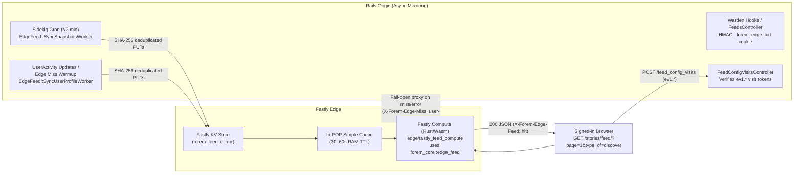

# Fastly Edge Compute Custom Home Feed Mirror (Proof of Concept)

> **Status:** Proof of Concept — completely gated behind the `:fastly_edge_feed_mirror` feature flag and `FASTLY_FEED_KV_STORE_ID` / `FASTLY_EDGE_FEED_SECRET` environment variables. Disabled and inert by default.

## Motivation

Forem's signed-in custom home feed (`GET /stories/feed/?page=N&type_of=discover` with `feed_strategy = "configured"`) currently runs a personalized Postgres scoring query (`Articles::Feeds::Custom` + `FeedConfig#score_sql`), loads associations, and renders Jbuilder JSON on Rails dynos for every signed-in homepage visit — bypassing Fastly's signed-out edge cache (`Cache-Control: private, no-store`).

However, two properties of Forem's custom feed make it uniquely suited to run at **Fastly Edge Compute**:

1. **Small bounded candidate pool:** Only articles matching `Article.published.with_at_least_home_feed_minimum_score` within `feed_lookback_days` (default 10 days) qualify — typically a few hundred to a few thousand rows per subforem.
2. **Viewer-independent cards & pure-Rust core:** `stories/feeds/show.json.jbuilder` already renders cards independently of the viewer (only `url`, `current_user_signed_in`, and `feed_config` vary per request), and `gems/forem_native/crates/forem_core` is pure Rust with zero Ruby dependencies that compiles cleanly to `wasm32-wasip1`.

## End-to-End Architecture

## Fastly KV Store Key Layout & Resource Budget

Writes are deduplicated in `EdgeFeed::KvClient` via SHA-256 hashes cached in `Rails.cache` so unchanged blobs trigger **zero** Fastly KV API calls. At the edge, shared keys are cached in Fastly's in-POP Simple Cache (`30–60s` TTL) so 99%+ of reads hit local POP RAM in <1 ms.

| KV Key | Contents | Typical Size (2,000 articles) | Sync Cadence |
| :--- | :--- | :--- | :--- |
| `host_map` | `{ domain => subforem_id }` | < 1 KB | Every 2 min (if changed) |
| `snapshot:<subforem_id>` | Qualified article scoring fields, active `FeedConfig`s, settings, `pinned_article_id` | ~400–600 KB | Every 2 min (if changed) |
| `cards:<subforem_id>:<0..7>` | 8 hash-sharded maps of pre-rendered viewer-independent story card JSONs | ~300–500 KB / shard | Every 2 min (only changed shards) |
| `embeddings:<subforem_id>` | Symmetric `int8`-quantized 768-dim vectors for 30-day articles | ~1.5 MB | Every 2 min (if changed), loaded only when `semantic_similarity_weight > 0` |
| `user:<user_id>` | Compact `EdgeUserProfile` (`UserActivity`, blocks, hidden tags, languages, AI prefs, `targeting_bucket`, `interest_embedding`) | ~2–5 KB | Lazily on `UserActivity` update or edge-miss warmup |

## How Key Challenges Are Handled

1. **Edge Authentication without Decrypting Rails Sessions:**
   - On login (`config/initializers/warden_hooks.rb`) or origin fallback (`Stories::FeedsController`), Rails sets an `HttpOnly`, `SameSite=Lax` HMAC-SHA256 cookie `_forem_edge_uid` (`eu1.<payload>.<sig>`).
   - Fastly Compute verifies it in constant time using `edge_feed_secret` from Fastly Secret Store. Missing/expired/invalid cookies transparently fall back to Rails origin.
2. **Full 29-Weight Scoring Parity in Pure Rust (`forem_core::edge_feed`):**
   - Evaluates every term of `FeedConfig#score_sql` (including recency, comment recency, U-shaped `published_at_diversity_weight`, lookback window, recent subforem multiplicity, AI disclosure matching/penalties, clickbait/compellingness, language match, randomness, and two-stage semantic candidate windowing).
   - Reuses `forem_core::feed::{FeedScoreWeights, weighted_shuffle_indices, calculate_dynamic_shuffle_count}` and applies `apply_published_at_diversity` + pinned article prepending in the exact order of `Articles::Feeds::Custom`.
3. **768-Dim Semantic Similarity at the Edge:**
   - Mirrors article embeddings quantized to symmetric `int8` (`[-127, 127]` + per-vector `scale`), cutting payload size by 4× while keeping >0.999 cosine similarity fidelity.
   - Two-stage candidate windowing restricts dot-product evaluation to the top `semantic_candidate_limit` (100–1,000) candidates, running in <1 ms inside Wasm.
4. **Sticky `FeedConfig` Assignments & `X-Feed-Visit-Token` Without Edge DB Writes:**
   - On page 1, Fastly Compute tracks sticky assignment in an HMAC-signed cookie (`_forem_edge_fc`, prefix `ec1.`) and mints `X-Feed-Visit-Token` (`ev1.`) directly at the edge.
   - `Feeds::RecordConfigVisit` verifies `ev1.` tokens using the shared HMAC secret and lazily creates/locks the `FeedConfigAssignment` row only when the browser actually reports a visible homepage visit, preserving full receipt deduplication and cooldown enforcement.
5. **Fail-Open Reliability:**
   - Any non-eligible route (`following`, `curated`, `latest`, tags, timeframes, signed-out, non-`configured` strategy), missing KV key, cold user profile, incomplete card shard, or runtime error proxies cleanly to `forem_origin` with an `X-Forem-Edge-Feed: fallback:<reason>` diagnostic header.

## Configuration & Rollout Checklist (POC)

1. Provision a Fastly KV Store (`forem_feed_mirror`) and Fastly Secret Store (`forem_edge_secrets` with key `edge_feed_secret`).
2. Configure Rails environment variables:
   - `FASTLY_API_KEY` (already used for Fastly purges/TLS)
   - `FASTLY_FEED_KV_STORE_ID`
   - `FASTLY_EDGE_FEED_SECRET` (matches Fastly Secret Store `edge_feed_secret`)
3. Deploy `edge/fastly_feed_compute` (`fastly compute build && fastly compute deploy`).
4. Enable the `:fastly_edge_feed_mirror` feature flag via the Admin Feature Flags UI.
5. Monitor `edge_feed.kv.*` stats, `X-Forem-Edge-Feed` response headers, and `FeedConfig` repeat-visit metrics before expanding traffic routing.

## Known POC Limitations / Next Steps

- **Eventual consistency:** Newly published/unpublished articles, reaction counts, and user blocks/mutes reflect at the edge on the next sync cycle (≤2 min for snapshots, next `UserActivity` refresh for user profiles). For immediate unpublish/block invalidation, model callbacks can enqueue `SyncSnapshotsWorker` / `SyncUserProfileWorker` with debounce locks.
- **KV write volume at scale:** Sharded snapshots keep article writes tiny (~10 PUTs / 2 min). If active-user profile updates exceed Fastly KV write budgets at peak traffic, `EdgeFeed::KvClient` can be swapped to an HTTP-accessible Redis store (e.g., Upstash) for `user:*` keys while keeping shared snapshots in Fastly KV + POP Cache.
- **Compression:** For very large subforems (>3,000 qualified articles), gzip-compressing `snapshot:*`, `cards:*`, and `embeddings:*` payloads (or switching to binary encoding) will further reduce KV transfer and Wasm parse time.
- **Shadow-mode verification:** Adding a dark-launch comparison harness that logs ranking overlap between Rails `Articles::Feeds::Custom` and `forem_core::edge_feed` is recommended prior to production cutover.
