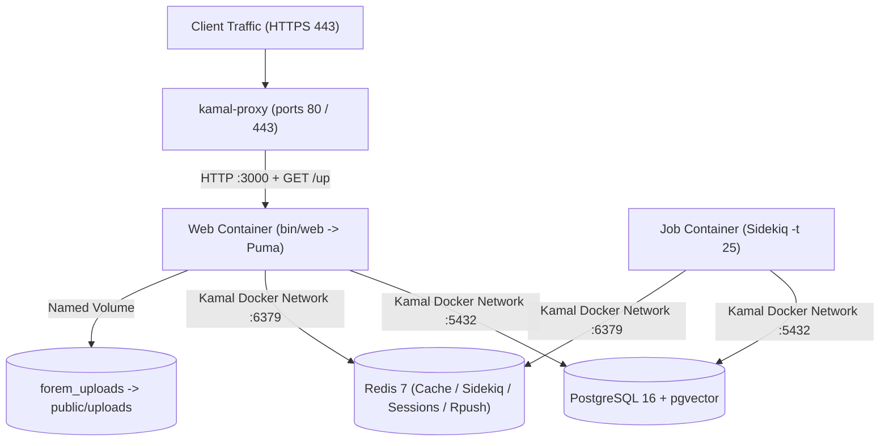

# Forem End-to-End Deployment Guide (Kamal 2)

This guide covers deploying Forem with [Kamal 2](https://kamal-deploy.org/) (`v2.12+`) across single bare-metal servers, DigitalOcean Droplets, managed database/cache setups, behind-CDN/load-balancer topologies, and multi-node clusters.

---

## 1. 5-Minute Quickstart (Single Server / DigitalOcean Droplet)

Out of the box, [config/deploy.yml](../config/deploy.yml) is tuned so a **single Ubuntu/Debian server or DigitalOcean Droplet** requires **zero external accounts** (no external container registry, no external database host, no external S3 bucket required to get started).

### Prerequisites

1. **Target server**: A fresh Ubuntu 22.04/24.04 or Debian VPS/bare-metal machine (4 GB+ RAM recommended, or 2 GB RAM + 2–4 GB swap) with SSH key access (`root` or a sudo/docker user).
   - The server needs GNU coreutils `cp`.  Kamal's asset bridging (`asset_path`) runs `cp -rnT`, which copies nothing on BusyBox (Alpine, Wolfi) and still exits 0.  The deploy then succeeds, but every page returns 500 (`couldn't find file 'ahoy.js/dist/ahoy.js'`).  On those systems, run `apk add coreutils` first.
2. **Local workstation**: Docker (with Buildx) and Ruby/Bundler (`bundle install`) so you can run `bundle exec kamal`.
   - `bundle install` needs the exact Ruby in `.ruby-version`, plus headers for native gems such as `pg`.  If you only want to deploy, install Kamal on its own instead and run `kamal` wherever this guide says `bundle exec kamal`:
     ```bash
     gem install --no-document kamal -v 2.12.0   # any Ruby >= 3.1
     ```
   - Clone with `git clone --depth 1`.  `.git/` is part of the build context (the entrypoint reads the build SHA from it), so a full clone sends about 2 GB of context on every build; a shallow clone sends about 370 MB.
3. **DNS**: Point an `A` record for your domain (e.g., `community.example.com`) to your server's public IPv4 address.
   - *No domain yet?* Either use a wildcard DNS helper like `<ip-with-dashes>.sslip.io` for instant Let's Encrypt HTTPS, or deploy with `-d staging` for plain HTTP over the raw IP.

### Step-by-Step Setup

1. **Create your local environment file** (gitignored):

   ```bash
   (umask 077 && cp .env.kamal.example .env.kamal)
   ```

2. **Set the 4 required variables** in `.env.kamal`:

   ```bash
   KAMAL_HOST="203.0.113.10"
   APP_DOMAIN="community.example.com"
   SECRET_KEY_BASE="$(openssl rand -hex 64)"
   POSTGRES_PASSWORD="$(openssl rand -hex 24)"
   ```

   > **Tip**: You do **not** need to construct `DATABASE_URL` manually for the built-in `postgres` accessory — [.kamal/secrets-common](../.kamal/secrets-common) builds it automatically from `POSTGRES_PASSWORD` (safely URL-encoded).

3. **Load your environment and validate the Kamal config**.  Kamal reads the exported variables, not the file, so run the `source` line again after any edit to `.env.kamal`:

   ```bash
   set -a && source .env.kamal && set +a
   bundle exec kamal config
   ```

4. **Bootstrap and deploy**:

   ```bash
   bundle exec kamal setup
   ```

   On that single command, Kamal will:
   - Install Docker on the target server if missing and start `kamal-proxy` (ports `80`/`443` with automatic Let's Encrypt TLS).
   - Start `forem-postgres` (`pgvector/pgvector:pg16`) and `forem-redis` (`redis:7-alpine`), bound strictly to `127.0.0.1` so database and Redis ports stay closed to the public internet.
   - Build Forem's `Containerfile` (`production` stage) locally, push it to Kamal's built-in `localhost:5555` registry, and pull it onto the server over SSH.
   - Boot the `web` container (`bin/web`), wait for Postgres/Redis, run `app_initializer:setup` (`db:prepare`, migrations, `forem:setup`), pass the zero-auth `GET /up` readiness probe, and then boot the `job` (Sidekiq) container.

5. **Subsequent zero-downtime deploys & rollbacks**:

   ```bash
   bundle exec kamal deploy
   bundle exec kamal rollback <version-sha>
   ```

---

## 2. Architecture & Built-In Safeguards



Key behaviors built into Forem's Kamal setup:

- **Zero-auth `/up` readiness probe**: [Middlewares::HealthCheck](../app/lib/middlewares/health_check.rb) handles `GET`/`HEAD /up` before `SetSubforem` and `SetCookieDomain` so readiness probes succeed even during initial `kamal setup` before DB tables exist. [production.rb](../config/environments/production.rb) also excludes `/up` from `force_ssl` redirects and `host_authorization`.
- **Full `bin/web` tuning**: The `web` role runs `bundle exec ruby bin/web`, preserving `LocalRedis::WebEnvironment` (`WEB_*` YJIT/GC/jemalloc overrides) and optional per-host `LOCAL_REDIS_URL` L1 cache support.
- **Graceful shutdown (`stop_timeout: 30`)**: Matches Puma's `25s` `worker_shutdown_timeout` and Sidekiq's `-t 25` shutdown window so rolling deploys drain cleanly without `SIGKILL`.
- **Asset bridging**: `asset_path: /opt/apps/forem/public/assets` merges old and new fingerprinted assets across rolling deploys to eliminate 404s on in-flight requests.
- **Local upload persistence**: On single-server deployments without S3/Spaces, `forem_uploads:/opt/apps/forem/public/uploads` persists CarrierWave file uploads across container replacements.
- **Accessory firewall safety**: `postgres` and `redis` publish on `127.0.0.1:5432:5432` and `127.0.0.1:6379:6379` by default so Docker's `iptables` rules never expose them on public interfaces.
- **Automatic DB prepare (`AUTO_PREPARE_DB`)**: When `AUTO_PREPARE_DB="true"`, [scripts/entrypoint.sh](../scripts/entrypoint.sh) waits for Postgres/Redis and runs `bundle exec rails app_initializer:setup` before starting the web server. Disable it (`AUTO_PREPARE_DB="false"`) in multi-node clusters and run migrations explicitly via `bundle exec kamal migrate -d cluster`.

---

## 3. Hosting Context Profiles (`-d` Destinations)

Forem ships destination overlays under `config/deploy.<destination>.yml` that merge cleanly onto [config/deploy.yml](../config/deploy.yml):

| Context | Command | Registry | DB & Redis | Proxy / SSL | Uploads | Auto DB Prepare |
| :--- | :--- | :--- | :--- | :--- | :--- | :--- |
| **Single Bare Metal / DO Droplet** | `bundle exec kamal setup` | Local `localhost:5555` | Local `pg16` + `redis:7` accessories (`127.0.0.1`) | Let's Encrypt (`ssl: true`, `forward_headers: true`) | `forem_uploads` volume | `true` |
| **Managed DB & Cache** | `bundle exec kamal setup -d managed` | Local or external | Managed PG (`pgvector`) + Managed Redis/Valkey | Let's Encrypt (`ssl: true`, `forward_headers: true`) | S3 / DO Spaces / R2 (or `KAMAL_LOCAL_UPLOADS=true`) | `true` |
| **Multi-Node Cluster** | `bundle exec kamal setup -d cluster` | External (GHCR / DOCR / ECR / GAR) | Managed PG + Managed Redis | External LB/CDN (`ssl: false`) or custom PEM certs | S3 / DO Spaces / R2 | `false` (`kamal migrate -d cluster`) |
| **Behind Cloudflare / Fastly / LB** | `bundle exec kamal setup -d edge` | Local or external | Local accessories (or `KAMAL_ACCESSORIES=false`) | `ssl: false`, `ssl_redirect: false`, `forward_headers: true` | Local volume or S3/Spaces | `true` |
| **Raw-IP / VM Preview (No DNS)** | `bundle exec kamal setup -d staging` | Local | Local accessories | HTTP port `80` (`ssl: false`, any host) | `forem_uploads` volume | `true` |

### Profile Examples

#### A. Managed PostgreSQL & Redis (`-d managed`)

Uses [config/deploy.managed.yml](../config/deploy.managed.yml). Local `postgres` and `redis` accessories are disabled automatically. Only `REDIS_URL` is required if all Redis consumers share one managed Valkey/Redis instance (`.kamal/secrets-common` automatically inherits `REDIS_URL` into `REDIS_SIDEKIQ_URL`, `REDIS_SESSIONS_URL`, and `REDIS_RPUSH_URL` unless specialized URLs are provided):

```bash
export KAMAL_HOST="203.0.113.10"
export APP_DOMAIN="community.example.com"
export SECRET_KEY_BASE="$(openssl rand -hex 64)"
export DATABASE_URL="<your-managed-postgres-connection-uri>"
export REDIS_URL="rediss://<your-redis-host>:25061/1"

bundle exec kamal setup -d managed
```

#### B. Multi-Server Cluster (`-d cluster`)

Uses [config/deploy.cluster.yml](../config/deploy.cluster.yml) for multiple `web` hosts (`boot.limit: 50%`, `boot.wait: 5`), dedicated `job` hosts, an external registry, managed DB/Redis, and object storage:

```bash
export KAMAL_WEB_HOSTS="10.10.0.11,10.10.0.12"
export KAMAL_JOB_HOSTS="10.10.0.21"
export KAMAL_REGISTRY_SERVER="registry.digitalocean.com"
export KAMAL_REGISTRY_USERNAME="your-do-email-or-token"
export KAMAL_REGISTRY_PASSWORD="your-do-registry-token"
export KAMAL_IMAGE="your-registry-name/forem"
export APP_DOMAIN="community.example.com"
export SECRET_KEY_BASE="..."
export DATABASE_URL="<your-managed-postgres-connection-uri>"
export REDIS_URL="rediss://<your-redis-host>:25061/1"
# Optional: if your LB healthchecks `/up` using the droplet's IP instead of APP_DOMAIN:
export KAMAL_PROXY_ANY_HOST="true"

# Run migrations once on the primary web host, then roll out the fleet:
bundle exec kamal migrate -d cluster
bundle exec kamal deploy -d cluster
```

> **Custom SSL Certs on Multi-Host**: If you terminate TLS directly on multiple web hosts instead of a Load Balancer, set `KAMAL_CUSTOM_SSL_CERT="true"` and provide `CERTIFICATE_PEM` and `PRIVATE_KEY_PEM` in `.kamal/secrets.cluster` (or ENV).

#### C. Behind Cloudflare / Fastly / Load Balancer (`-d edge`)

Uses [config/deploy.edge.yml](../config/deploy.edge.yml). Disables Let's Encrypt on the droplet while telling Rails the request arrived over HTTPS (`RAILS_ASSUME_SSL=true`, `FORCE_SSL_IN_RAILS=true`). `TRUST_X_FORWARDED_HOST` stays `false` by default (enable it only if your trusted ingress rewrites `Host` and strips client-supplied `X-Forwarded-Host`):

```bash
bundle exec kamal setup -d edge
```

#### D. Pre-DNS / Raw-IP / Local VM Testing (`-d staging`)

Uses [config/deploy.staging.yml](../config/deploy.staging.yml). Serves over plain HTTP (`http://203.0.113.10`) with no Let's Encrypt ACME challenge:

```bash
export KAMAL_HOST="203.0.113.10"
export APP_DOMAIN="203.0.113.10"
export SECRET_KEY_BASE="$(openssl rand -hex 64)"
export POSTGRES_PASSWORD="$(openssl rand -hex 24)"

bundle exec kamal setup -d staging
```

---

## 4. Container Registries & Multi-Arch Builders

### Registry Options

- **Built-in Local Registry (default)**: `KAMAL_REGISTRY_SERVER` defaults to `localhost:5555`. Kamal spins up `registry:3` locally on `127.0.0.1:5555`, pushes your image, and forwards the registry port over SSH to every server. **No external registry credentials required.**  The forward is an SSH *remote* forward (`ssh -R`).  If your SSH path refuses it (some bastions and gateways, or `AllowTcpForwarding local`), `kamal setup` stops with `Failed to establish port forward`; use an external registry instead.
- **DigitalOcean Container Registry (DOCR)**:
  ```bash
  export KAMAL_REGISTRY_SERVER="registry.digitalocean.com"
  export KAMAL_REGISTRY_USERNAME="doctl-or-token"
  export KAMAL_REGISTRY_PASSWORD="$DIGITALOCEAN_ACCESS_TOKEN"
  export KAMAL_IMAGE="<registry-name>/forem"
  ```
- **GitHub Container Registry (GHCR)**:
  ```bash
  export KAMAL_REGISTRY_SERVER="ghcr.io"
  export KAMAL_REGISTRY_USERNAME="your-github-username"
  export KAMAL_REGISTRY_PASSWORD="$GITHUB_PAT_WITH_WRITE_PACKAGES"
  export KAMAL_IMAGE="your-github-username/forem"
  ```
- **Docker Hub**: Set `KAMAL_REGISTRY_SERVER="docker.io"`, `KAMAL_REGISTRY_USERNAME`, `KAMAL_REGISTRY_PASSWORD`, `KAMAL_IMAGE="youruser/forem"`.
- **AWS ECR / GCP Artifact Registry**: Set `KAMAL_REGISTRY_SERVER` to your `<account>.dkr.ecr.<region>.amazonaws.com` or `<region>-docker.pkg.dev` endpoint (see `bundle exec kamal docs registry` for dynamic token snippets).

### CPU Architecture & Apple Silicon Builds

- `KAMAL_ARCH` defaults to `amd64`.
- For ARM servers (e.g., Hetzner CAX, AWS Graviton, ARM VPS), set `export KAMAL_ARCH="arm64"`.
- **Where the image is built**: Kamal's `builder.local` defaults to `true`, so `KAMAL_REMOTE_BUILDER` is used only when your workstation's architecture differs from `KAMAL_ARCH`.  From an `amd64` workstation the image is built locally and pushed over your uplink.  Set `KAMAL_BUILDER_LOCAL="false"` to always build on `KAMAL_REMOTE_BUILDER`.
- **Remote builder with an external registry**: Kamal does not run `docker login` on your workstation when it uses a remote builder, but Buildx still pushes with your workstation's credentials.  Run `docker login <registry>` locally before `kamal setup`, or the push fails with `401 Unauthorized` after the whole build.
- **Deploying from an Apple Silicon Mac to an `amd64` server**: Local QEMU cross-compilation of Rust (`forem_native`) + Node/Ruby native gems is slow. You can point Kamal at any `amd64` Linux build box (or a temporary build droplet) via SSH:
  ```bash
  export KAMAL_REMOTE_BUILDER="ssh://root@your-amd64-builder-ip"
  ```

---

## 5. Object Storage Options

1. **Local Persistent Volume (Default for single-server)**:
   When `AWS_ID` is unset, [CarrierWaveInitializer](../config/initializers/carrierwave.rb) uses `:file` storage in `public/uploads`, backed by the `forem_uploads` Docker named volume.
2. **AWS S3**:
   Set `AWS_ID`, `AWS_SECRET`, `AWS_BUCKET_NAME`, `AWS_UPLOAD_REGION`.
3. **DigitalOcean Spaces (with optional Spaces CDN)**:
   ```bash
   export AWS_ID="your-spaces-access-key"
   export AWS_SECRET="your-spaces-secret-key"
   export AWS_BUCKET_NAME="your-space-name"
   export AWS_UPLOAD_REGION="nyc3"
   export AWS_ENDPOINT="https://nyc3.digitaloceanspaces.com"
   # Optional CDN URL for served images:
   export CARRIERWAVE_ASSET_HOST="https://your-space-name.nyc3.cdn.digitaloceanspaces.com"
   ```
4. **Cloudflare R2 / MinIO / S3-Compatible**:
   ```bash
   export AWS_ID="your-r2-or-minio-key"
   export AWS_SECRET="your-r2-or-minio-secret"
   export AWS_BUCKET_NAME="your-bucket"
   export AWS_UPLOAD_REGION="auto"              # or "us-east-1" for MinIO
   export AWS_ENDPOINT="https://<account-id>.r2.cloudflarestorage.com"
   export AWS_PATH_STYLE="true"                 # required for MinIO / IP endpoints
   export CARRIERWAVE_ASSET_HOST="https://media.example.com"
   ```

---

## 6. Cloud & Bare-Metal Provider Guides

### DigitalOcean

- **Single Droplet**: Ubuntu 24.04 droplet (4 GB+ RAM recommended; add a 2–4 GB swapfile on 2 GB droplets during heavy Rust/asset builds if building on-host).
- **DigitalOcean Cloud Firewall**: Allow inbound TCP `22` (SSH), `80` (HTTP/ACME), `443` (HTTPS). Keep `5432` and `6379` closed externally.
- **VPC Multi-Node Accessories**: If you run `postgres` and `redis` on a separate droplet in the same DO VPC (`10.x.x.x`), set:
  ```bash
  export KAMAL_DB_IP="10.x.x.x"
  export KAMAL_REDIS_IP="10.x.x.x"
  export KAMAL_DB_PORT="10.x.x.x:5432:5432"
  export KAMAL_REDIS_PORT="10.x.x.x:6379:6379"
  # Set DATABASE_URL to the postgres accessory on the VPC host (host 10.x.x.x:5432, db forem_production)
  export DATABASE_URL="<your-vpc-postgres-connection-uri>"
  export REDIS_URL="redis://10.x.x.x:6379/1"
  export KAMAL_EXTERNAL_REDIS="true"
  ```
- **DO Managed PostgreSQL**: Ensure the `vector` extension (`pgvector`) is available on your Managed PG plan/version (`CREATE EXTENSION IF NOT EXISTS vector;`).

### Hetzner Cloud

- **Private Network**: Bind accessory ports to your Hetzner vSwitch IP (`KAMAL_DB_PORT="10.0.0.x:5432:5432"`).
- **Gotcha (Docker MTU)**: On some Hetzner vSwitch/cloud networks, packet fragmentation can stall Docker pulls/pushes. Set `"mtu": 1450` in `/etc/docker/daemon.json` and restart Docker if you see TLS/push hangs.

### Non-Root SSH & Bare Metal Hardening

To deploy as a non-root user (`KAMAL_SSH_USER="deploy"`, `KAMAL_SSH_PORT="2222"`):

```bash
# On the target server (once):
sudo apt update && sudo apt install -y docker.io curl git
sudo adduser --disabled-password deploy
sudo usermod -aG docker deploy
```

> **Firewall Note**: Ubuntu's `ufw` does not automatically block ports published by Docker on `0.0.0.0`. Forem's `config/deploy.yml` avoids this by binding Postgres and Redis to `127.0.0.1` by default, and still recommends enabling your cloud provider's external firewall.

### Cloudflare & Fastly

- **Cloudflare**:
  - If terminating TLS on the server with Let's Encrypt (default `proxy.ssl: true`), set Cloudflare SSL/TLS mode to **Full (strict)**. Never use **Flexible** (it sends HTTP to `kamal-proxy` while Rails expects HTTPS, causing redirect loops).
  - If using Cloudflare Origin/Edge termination with `-d edge`, `kamal-proxy` accepts plain HTTP (`ssl: false`) while Rails honors `RAILS_ASSUME_SSL=true`.

---

## 7. Secrets Management & Pre-Deploy Checks

- [.kamal/secrets-common](../.kamal/secrets-common) maps environment variables for all destinations and automatically synthesizes `DATABASE_URL` (from `POSTGRES_PASSWORD`) and `REDIS_*_URL` (from `REDIS_URL`) when specialized values are omitted.
- [.kamal/secrets](../.kamal/secrets) (and optional `.kamal/secrets.<destination>` files) can fetch secrets directly from 1Password, Bitwarden, AWS Secrets Manager, or Doppler via `kamal secrets fetch`.
- [.kamal/hooks/pre-deploy](../.kamal/hooks/pre-deploy) validates that `SECRET_KEY_BASE`, `DATABASE_URL` (and `POSTGRES_PASSWORD` / `REDIS_URL` when required by the active topology) are non-empty before booting containers. Bypass with `--skip-hooks` or `KAMAL_SKIP_SECRET_CHECK=true`.

---

## 8. Day-2 Operations, Backups & Troubleshooting

### Built-In Kamal Aliases

```bash
# Rails console in the running web container
bundle exec kamal console

# Interactive bash shell
bundle exec kamal shell

# Follow web or Sidekiq logs
bundle exec kamal logs
bundle exec kamal job-logs

# Run migrations + forem:setup manually
bundle exec kamal migrate

# PostgreSQL / Redis shells on the accessory containers
bundle exec kamal dbc
bundle exec kamal redis-cli

# Retrieve the Forem health check token (for /api/health_checks/*)
bundle exec kamal health-token
```

*(Append `-d <destination>` to any command above when targeting a named destination.)*

### PostgreSQL Backups & Restores (Local Accessory)

```bash
# Dump compressed backup to your local machine
bundle exec kamal accessory exec postgres --reuse \
  "pg_dump -U postgres -Fc forem_production" > forem_$(date +%F).dump

# Restore from a dump
cat forem_2026-11-18.dump | bundle exec kamal accessory exec postgres -i --reuse \
  "pg_restore -U postgres -d forem_production --clean --if-exists"
```

### Database Connection Pool Sizing

Forem configures each Sidekiq process's DB pool dynamically as `SIDEKIQ_CONCURRENCY + 5` and each Puma worker as `RAILS_MAX_THREADS + 5`. Ensure PostgreSQL's `max_connections` comfortably exceeds:

$$\text{Total Connections} = (\text{Web Containers} \times \text{WEB\_CONCURRENCY} \times (\text{RAILS\_MAX\_THREADS} + 5)) + (\text{Sidekiq Containers} \times (\text{SIDEKIQ\_CONCURRENCY} + 5))$$

### Upgrading an Existing `pg13` Kamal Accessory to `pg16`

This configuration defaults to `pgvector/pgvector:pg16` (PostgreSQL 13 reached EOL in November 2025). If an existing host already initialized a volume with `pg13`, either keep `export KAMAL_POSTGRES_IMAGE="pgvector/pgvector:pg13"` until you migrate, or dump with `pg_dump` before recreating the Postgres accessory volume with `pg16`.

---

## 9. Security Boundaries & Deployment Invariants

When adapting these profiles to real infrastructure, maintain these invariants:

1. **Edge / LB / Cluster Origin Isolation (`-d edge`, `-d cluster`)**:
   - Because `-d edge` and `-d cluster` disable TLS on `kamal-proxy` (`proxy.ssl: false`) and set `RAILS_ASSUME_SSL=true`, **restrict origin ports `80`/`443` via cloud firewalls or VPC rules exclusively to your trusted LB/CDN IPs** so clients cannot bypass edge TLS, WAF, or rate limits.
   - Use verified origin TLS (e.g., Cloudflare Origin CA + `KAMAL_CUSTOM_SSL_CERT=true`) across untrusted links between edge and origin.
   - Strip or overwrite client-supplied `X-Forwarded-For`, `X-Forwarded-Proto`, `X-Forwarded-Host`, `Fastly-Orig-Host`, and `X-Forem-Original-Host` headers at the edge ingress, and keep `TRUST_X_FORWARDED_HOST="false"` unless your ingress explicitly requires it.
2. **Staging / Pre-DNS Raw-IP Isolation (`-d staging`)**:
   - `-d staging` disables HTTPS (`proxy.ssl: false`, `FORCE_SSL_IN_RAILS=false`) and should **only** be used with synthetic data behind a VPN or IP allowlist — never with production accounts or credentials.
   - Isolate staging `SECRET_KEY_BASE`, databases, Redis, and buckets from production. If multiple destinations share a Docker host, set a distinct `KAMAL_SERVICE` (e.g. `forem-staging`) so accessories and containers stay isolated (upload volumes are already scoped by `KAMAL_SERVICE` and `KAMAL_DESTINATION`).
3. **S3-Compatible Object Storage & Private Agent Sessions (`AWS_ENDPOINT`)**:
   - Always use `https://` for external `AWS_ENDPOINT` URLs (`http://` is only appropriate for an isolated private-network MinIO container).
   - Scope storage credentials to only the required buckets/prefixes, configure a dedicated private `AWS_AGENT_SESSIONS_BUCKET_NAME` with public/unsigned reads disabled (do not reuse a public media bucket for private agent sessions), and verify presigned URLs work while anonymous `GET` is denied.
4. **Database & Redis Network Controls**:
   - On single-host deploys, keep the default `127.0.0.1` accessory port bindings (`KAMAL_DB_PORT`, `KAMAL_REDIS_PORT`).
   - When splitting accessories across VPC hosts or connecting to managed PostgreSQL/Redis, enforce source IP allowlists, require Redis authentication (`requirepass` / ACLs), and require verified TLS (`rediss://`, `sslmode=require` or `verify-full`).
5. **Public Liveness Probe (`/up`) & Build/Operator Trust**:
   - Keep `GET`/`HEAD /up` ([Middlewares::HealthCheck](../app/lib/middlewares/health_check.rb)) strictly dependency-free, non-cacheable (`Cache-Control: no-store`), and free of tenant/diagnostic data; keep DB/Redis readiness checks on the authenticated `/api/health_checks/*` endpoints.
   - Treat SSH keys, `KAMAL_REMOTE_BUILDER` hosts, and container registries as privileged production artifact producers; keep `.env*` and `.kamal/` excluded from build contexts (enforced via `.dockerignore`).

